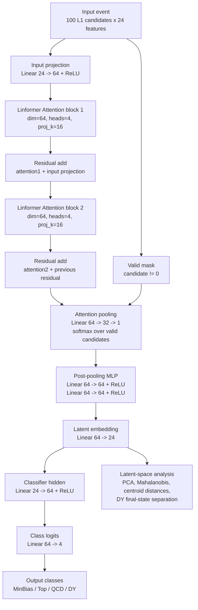
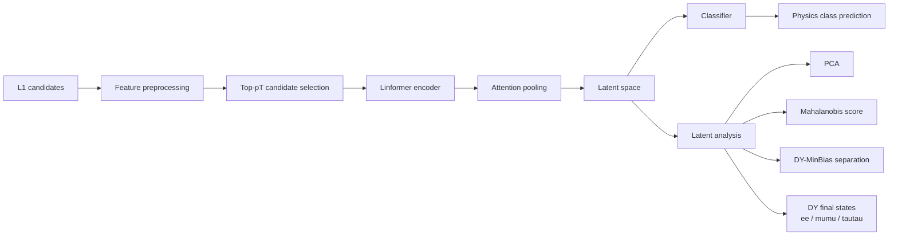

# openlab_ss26

Repository for the CERN Openlab Summer Student 2026 project:

**NGT WP3 Representation Learning for LHC Triggers**

The project studies machine-learning representations of simulated LHC collision
events for Level-1 trigger and anomaly-detection workflows. The main objective
is to learn compact latent spaces where Standard Model processes cluster in a
physically meaningful way while preserving sensitivity to rare or anomalous
signatures.

Project notes and meeting context are tracked in the CERN CodiMD page:

- <https://codimd.web.cern.ch/s/oEeoJz7QJ>

## Scientific Context

Collider events are represented as unordered sets of reconstructed or trigger
objects:

```text
X in R^(N_particles x N_features)
```

The current work focuses on particle-level L1 trigger candidates from the
Collide-2V / Collide-1M dataset, using features such as:

- transverse momentum: `pt`
- pseudorapidity: `eta`
- azimuthal angle: `phi`
- transverse impact parameter / displacement proxy: `dxy` or `D0`
- particle identifier: `pdgId` / `PID`

The project evaluates how different representation-learning strategies and
model scales affect downstream classification and anomaly-detection behavior.

## Repository Layout

```text
.
├── README.md
└── ctl2_embedding_model/
    ├── NGT_Linformer_NodesAligned_FullPrecision_Collide2V_L1features.ipynb
    ├── Run_Baseline_1k_100k.md
    ├── Run_DYMinBias_Followups.md
    ├── .gitlab-ci.yml
    ├── ctl2_model/
    │   ├── conf/
    │   ├── data/
    │   ├── src/ctl2_model/
    │   └── tests/
    └── ngt_linformer_nodes_aligned_outputs/
        └── runs/
```

### `ctl2_embedding_model/`

Main project workspace for the CTL2 / L1 particle-level representation-learning
studies.

Important files:

- `NGT_Linformer_NodesAligned_FullPrecision_Collide2V_L1features.ipynb`:
  main notebook used for the NGT Linformer experiments on Collide-2V classes.
- `Run_Baseline_1k_100k.md`:
  run notes and analysis summary for the first 1k and 100k baseline studies.
- `Run_DYMinBias_Followups.md`:
  follow-up notes for the wide-attention augmentation and 300k MinBias L1-only
  studies.
- `Run_TopPt_EtaFix_Analysis.md`:
  analysis of the eta-gap preprocessing fix and the three corrected top-pT
  runs performed on July 6, 2026.
- `Run_DY_MinBias_Latent_Analysis.md`:
  analysis of the DY-MinBias latent-space overlap, including the DY gen-level
  final-state split into `ee`, `mumu`, and `tautau`.
- `ctl2_model/`:
  Kedro-style project with reusable preprocessing, model, training,
  validation, plotting, anomaly-score, and synthesis code.
- `ngt_linformer_nodes_aligned_outputs/runs/`:
  saved run artifacts, figures, summaries, and model outputs.

Raw cached tensors are intentionally excluded from Git:

```text
ctl2_embedding_model/ngt_linformer_nodes_aligned_outputs/cache/
```

## Dataset

The project uses the public Collide-1M / Collide-2V dataset:

- Hugging Face dataset:
  <https://huggingface.co/datasets/fastmachinelearning/collide-1m>
- Example notebook:
  <https://huggingface.co/datasets/fastmachinelearning/collide-1m/blob/main/COLLIDE2V_example_notebook.ipynb>

Current experiments use four classes:

- `MinBias`
- `top`
- `QCD`
- `DY`

The main notebook loads class-specific samples, builds a fixed
`N_CONSTITUENTS x N_FEATURES` tensor, normalizes features from the training
split only, builds a PID mapping from the training split only, and trains a
full-precision Linformer-style classifier/embedding model.

## Current Model Workflow

The current baseline is a full-precision PyTorch analogue of the quantized /
HGQ Linformer model in `ctl2_model`.

Current wide-attention architecture:



Conceptual workflow:



The notebook evaluates:

- raw and preprocessed feature distributions
- multiclass classification performance
- latent-space PCA visualizations
- Mahalanobis anomaly scores using MinBias as the normal class
- DY vs MinBias diagnostic features and separability checks

## Main Runs Included

### 1k events per class smoke test

Purpose:

- verify end-to-end loading, preprocessing, training, embedding extraction, and
  anomaly scoring
- check alignment with the `ctl2_model` preprocessing and Linformer structure

Key result:

- the pipeline works end to end
- `top` and `qcd` are reasonably separable
- DY is strongly confused with MinBias

### 100k events per class baseline

Purpose:

- production-scale NGT run requested in the first project meetings
- test whether DY-MinBias confusion disappears with more data

Key result:

- global accuracy improves relative to the 1k smoke test
- `top` and `qcd` improve
- DY-MinBias confusion persists, indicating that the issue is not simply sample
  size

### Wide attention + phi augmentation run

Purpose:

- test whether additional model capacity, attention pooling, and phi-rotation
  augmentation improve DY-MinBias separability

Key result:

- DY recall improves substantially
- MinBias becomes more frequently misclassified as DY
- the model changes the decision boundary but does not fully separate the two
  classes

## Current Physics / ML Findings

The central open problem is the separability of `DY` and `MinBias`.

Observed behavior:

- Scaling from 1k to 100k events does not solve DY -> MinBias confusion.
- Increasing model capacity and adding attention pooling improves DY recall,
  but introduces significant MinBias -> DY confusion.
- Mahalanobis scores separate `top` clearly and `qcd` partially, but typical
  DY events remain close to MinBias in the latent space.
- Simple event-level diagnostic features such as lepton multiplicity, photon
  multiplicity, scalar `pt` summaries, and approximate opposite-sign
  same-flavor lepton-pair mass provide only weak DY-MinBias separation.

Working interpretation:

- The limitation is likely not only model capacity.
- DY and MinBias may be weakly separable with the current L1 particle features,
  or the current representation may be missing explicit event-level physics
  observables.

## Next Analysis Questions

Questions to clarify with supervisors:

- Should DY be expected to separate cleanly from MinBias using only the current
  L1 particle-level features?
- Do many DY events lack visible L1 electron or muon candidates after the
  current preprocessing?
- Should the model include explicit event-level observables such as:
  - lepton counts
  - photon counts
  - scalar `sum_pt` / `HT`
  - leading-object `pt`
  - approximate dilepton mass
  - opposite-sign same-flavor pair counts
  - isolation-like summaries
- Should DY be split into subcategories, for example visible-lepton DY vs
  low-activity DY?
- Should DY-MinBias be studied as a dedicated binary task before expanding to
  additional physics classes?
- Would a contrastive or auxiliary loss help force latent separation between
  DY and MinBias?

## Running Locally

The notebook is designed primarily for NGT / Linux execution, but the smaller
1k-event configuration can be used for local smoke tests.

From the repository root:

```bash
cd ctl2_embedding_model
```

Open:

```text
NGT_Linformer_NodesAligned_FullPrecision_Collide2V_L1features.ipynb
```

For local debugging, set in the notebook:

```python
N_EVENTS_PER_CLASS = 1_000
NUM_WORKERS = 0
```

For NGT production-scale runs:

```python
N_EVENTS_PER_CLASS = 100_000
NUM_WORKERS = 4
```

The raw tensor cache is written under:

```text
ctl2_embedding_model/ngt_linformer_nodes_aligned_outputs/cache/
```

This directory is ignored by Git because it contains large regenerated data
artifacts.

## Kedro Project

Reusable project code is under:

```text
ctl2_embedding_model/ctl2_model/
```

Useful subdirectories:

- `src/ctl2_model/models/`
- `src/ctl2_model/pipelines/data_processing/`
- `src/ctl2_model/pipelines/model_training/`
- `src/ctl2_model/pipelines/model_validation/`
- `src/ctl2_model/evaluation/`
- `src/ctl2_model/utils/`

The notebook currently mirrors important parts of this code in full precision
to support direct NGT notebook development and comparison against the original
pipeline.

## Infrastructure

The project targets the CERN NGT infrastructure:

- PyTorch for model development
- NGT / Kubeflow notebooks for GPU execution
- GitLab for version control and CI
- MLflow planned for experiment tracking and model management

## Project Status

Current status:

- end-to-end Collide-2V Linformer workflow implemented
- 1k and 100k event studies completed
- wide attention + augmentation experiment completed
- DY-MinBias separability identified as the main bottleneck

Immediate next step:

- enrich the representation with stronger event-level physics observables or
  dedicated DY-MinBias objectives, then compare against the current
  `wide_attn_aug` run.

Planned follow-up run:

- `EXPERIMENT_PRESET = "minbias300k_l1_mean_no_aug"`
- load `300k` MinBias events and `100k` events for each other class
- use L1 candidate columns only, with FullReco fallbacks disabled
- use mean pooling instead of attention pooling
- keep validation and evaluation balanced across classes
- use balanced class weights during training to avoid learning only the
  increased MinBias prior

This run is meant to test whether a better-sampled MinBias normal class helps
the model learn MinBias-specific structure without relying on additional
non-L1 features.
