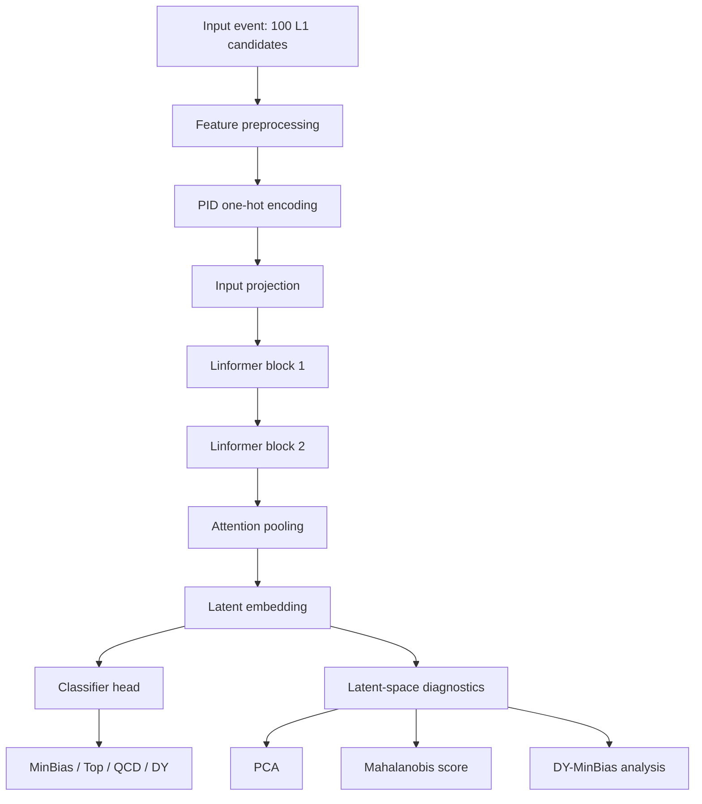

# openlab_ss26

Repository for the CERN Openlab Summer Student 2026 project:

**NGT WP3 Representation Learning for LHC Triggers**

This project studies machine-learning representations of simulated LHC collision events for Level-1 trigger and anomaly-detection workflows. The main objective is to learn compact latent spaces where Standard Model processes cluster in a physically meaningful way while preserving sensitivity to rare or anomalous signatures.

Project notes and meeting context are tracked in the CERN CodiMD page:

- <https://codimd.web.cern.ch/s/oEeoJz7QJ>

## Project Status

Current safe baseline:

- updated Collide-2V workflow implemented in the main notebook
- L1-only inputs from `L1T_PUPPIPart_*` branches
- 100,000 events per class for MinBias, Top, QCD, and DY
- top-pT candidate selection with 100 candidates per event
- full-precision PyTorch Linformer-style encoder
- wide attention + augmentation configuration preserved as the current comparison baseline
- latest run and analysis uploaded under `ctl2_embedding_model/ngt_linformer_nodes_aligned_outputs/runs/2026-07-11/`

Main current finding:

- Top remains well separated.
- QCD has moderate separation.
- DY still overlaps strongly with MinBias in the latent space.
- The updated Collide-2V baseline is now saved before future model changes.

## Repository Layout

```text
.
|-- README.md
`-- ctl2_embedding_model/
    |-- README.md
    |-- NGT_Linformer_NodesAligned_FullPrecision_Collide2V_L1features.ipynb
    |-- analysis/
    |-- ctl2_model/
    `-- ngt_linformer_nodes_aligned_outputs/
        `-- runs/
```

## Main Notebook

The current safe notebook is:

```text
ctl2_embedding_model/NGT_Linformer_NodesAligned_FullPrecision_Collide2V_L1features.ipynb
```

It is configured by default for updated Collide-2V:

- `DATA_SOURCE = 'collide2v_updated'`
- `N_EVENTS_PER_CLASS = 100_000`
- classes: `minbias`, `top`, `qcd`, `dy`
- L1-only selected columns:
  - `L1T_PUPPIPart_PT`
  - `L1T_PUPPIPart_Eta`
  - `L1T_PUPPIPart_Phi`
  - `L1T_PUPPIPart_D0`
  - `L1T_PUPPIPart_PID`

The notebook produces:

- raw and preprocessed feature distributions
- training history
- multiclass evaluation metrics
- confusion matrices
- latent-space PCA
- Mahalanobis anomaly scores using MinBias as the reference class
- DY-MinBias event-level diagnostic summaries

## Model Workflow

The current model is a full-precision PyTorch Linformer-style encoder aligned with the tensor structure and preprocessing logic from `ctl2_model`. It is not a bit-for-bit copy of the original Keras/HGQ implementation, but it keeps the same high-level representation-learning structure.



## Dataset Context

The project has compared three dataset/input sources during development:

- Hugging Face Collide-2V / Collide-1M samples
- ROOT-based L1 samples from `samples.json`
- updated Collide-2V production parquet files

The current safe baseline uses the updated Collide-2V production parquets. The displacement-like input is `L1T_PUPPIPart_D0`, which is concentrated near zero with rare large outliers. This distribution differs from the ROOT `L1PuppiCands_dxy` behavior observed in earlier diagnostics, so the updated Collide-2V baseline should be treated as its own reference point.

## Run Analyses

English analysis notes are stored in:

```text
ctl2_embedding_model/analysis/
```

Current analysis index:

- `2026-07-01_baseline_1k_100k.md`: first 1k and 100k baseline runs
- `2026-07-02_03_dy_minbias_followups.md`: wide attention, augmentation, and 300k MinBias follow-up studies
- `2026-07-06_top_pt_eta_fix.md`: top-pT selection and eta-gap correction runs
- `2026-07-08_dy_minbias_latent_space.md`: DY final-state and latent-space separation analysis
- `2026-07-09_dataset_diagnostics_and_runs.md`: HF vs ROOT vs updated Collide-2V dataset diagnostics
- `2026-07-11_updated_collide2v_run.md`: updated Collide-2V 100k-per-class safe baseline

## Latest Uploaded Run

The latest uploaded run is:

```text
ctl2_embedding_model/ngt_linformer_nodes_aligned_outputs/runs/2026-07-11/collide2v_updated_dy_minbias_wide_attn_aug_top_pt_minbias100000_top100000_qcd100000_dy100000_143554/
```

Key evaluation results:

| Class | Precision | Recall | F1-score |
|---|---:|---:|---:|
| MinBias | 0.433 | 0.733 | 0.544 |
| Top | 0.908 | 0.936 | 0.921 |
| QCD | 0.553 | 0.571 | 0.562 |
| DY | 0.527 | 0.128 | 0.206 |

Overall evaluation accuracy was approximately 0.592. The main limitation remains DY-MinBias overlap: 65.9 percent of true DY events were classified as MinBias in the multiclass evaluation.

## Output Policy

The following local output folders are intentionally ignored by git:

```text
ctl2_embedding_model/ngt_linformer_nodes_aligned_outputs/cache/
ctl2_embedding_model/ngt_linformer_nodes_aligned_outputs/diagnostic_notebooks/
ctl2_embedding_model/ngt_linformer_nodes_aligned_outputs/diagnostics/
```

Selected run artifacts under `ngt_linformer_nodes_aligned_outputs/runs/` are versioned when they are needed as evidence for the project analysis.
