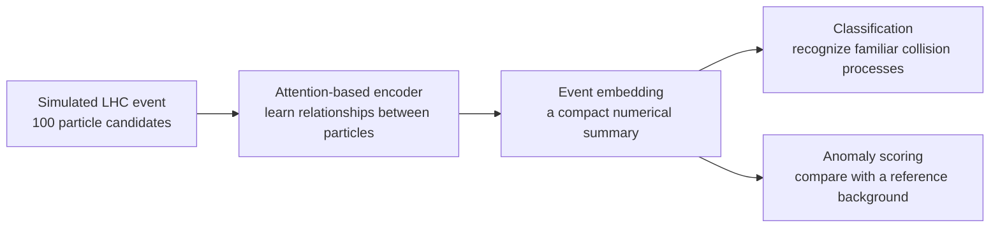
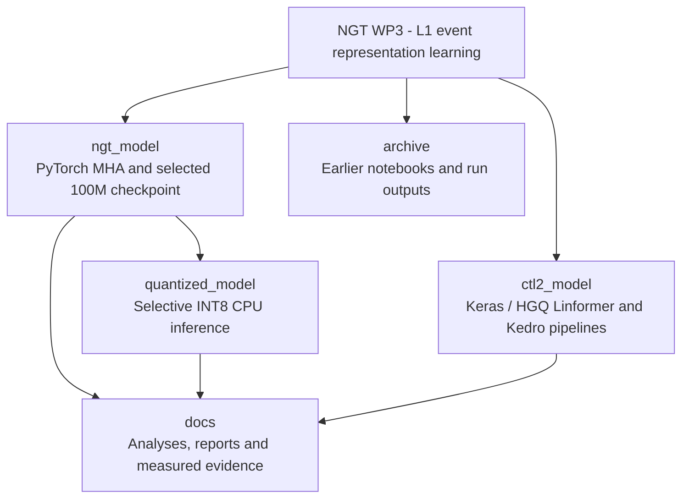

# NGT WP3: Representation Learning for LHC Triggers

**Learning compact descriptions of particle collisions to help identify rare and
unusual events.**

A CERN openlab Summer Student 2026 project within the **Next Generation Triggers
(NGT)** programme, Work Package 3 (WP3), studying machine learning for CMS at the Large
Hadron Collider (LHC).

## Why this project exists

An **event** is a snapshot of what the detector observes. Particle collisions at
the LHC produce more data than experiments can store.
A **trigger** is the system that quickly decides which events to keep for further
study. The **Level-1 (L1) trigger** makes the earliest selection, using the
information available within a strict time and hardware budget.

This project asks whether a neural network can turn that early particle
information into a compact, useful description of an entire event. Such a
description could help distinguish familiar collision patterns from events that
look unusual, supporting searches for rare physics processes.

## How it works

We use simulated events from **COLLIDE-2V**. Each event is represented by up to
100 particle candidates, described by five features: transverse momentum,
two direction coordinates, transverse displacement and particle identity.

An **attention-based encoder** learns relationships between these candidates and
produces an **embedding**: a short list of numbers summarizing the event. For the
delivered 100M-parameter model, that summary contains 128 numbers.



The main four-class study trains on familiar Standard Model processes: generic
minimum-bias collisions (**MinBias**), strong-interaction events (**QCD**),
**Drell-Yan** production and **top-quark** production. Anomaly scores then measure
how unusual an event looks in the learned space, including its distance from a
MinBias reference distribution.

Rare Higgs processes, including Higgs-pair decays to four bottom quarks (**HH4B**)
and vector-boson-fusion Higgs production (**VBFH**), are used as external evaluation
probes in this four-class study. They test sensitivity to known rare Standard
Model signals; the study does not establish a discovery of new physics.

## What we studied and learned

- **Representation quality:** classification accuracy, the structure of the
  embedding and anomaly sensitivity must be evaluated together. A model can use
  only a few of its available embedding dimensions, a behavior called *latent
  collapse*.
- **Scaling:** we varied training objectives, model capacity and dataset size.
  Stable experiments at one million events per class kept the most rare-signal
  events at matched background rejection among the tested configurations. Larger models
  required careful optimization to remain stable.
- **Large-scale training:** a model with approximately **100 million parameters**
  was trained on an **80-million-event configuration across four GPUs**. Five
  epochs are documented; the delivered checkpoint is epoch 4, selected by
  validation loss.
- **Quantization follow-up:** a selective 8-bit CPU prototype reduces the stored
  model artifact by **24.4%**, with **99.61% prediction agreement** with the
  full-precision model on a 512-event pilot. Independent physics validation and
  real-time hardware studies remain future work.

This repository contains an offline simulation study and research prototypes.
The detailed reports explain the evaluation samples, limitations and differences
between earlier experiments and the delivered models.

## Explore the repository

| Project | What you will find |
|---|---|
| [ngt_model/](ngt_model/README.md) | Main PyTorch attention model, training/evaluation tools and selected 100M checkpoint |
| [quantized_model/](quantized_model/README.md) | Selective INT8 conversion, CPU inference and numerical comparison tools |
| [ctl2_model/](ctl2_model/README.md) | Separate Keras/HGQ Linformer project with Kedro pipelines and hardware-synthesis source |

Start with the [technical report](docs/reports/NGT_Model_Technical_Report.md) for
the research methods, [analysis notes](docs/analysis/README.md) for individual
studies, or the [delivery guide](docs/DELIVERY.md) for exact checkpoint details.
[Documentation and diagrams](docs/README.md) are kept separately from
[historical notebooks and outputs](archive/README.md).

<details>
<summary>Repository map</summary>



</details>

## Get started

```bash
git lfs install
git clone https://github.com/imstefleon/NGT-WP3-Representation-Learning-LHC-Triggers.git
cd NGT-WP3-Representation-Learning-LHC-Triggers
git lfs pull
```

The two delivered model files use **Git LFS** and total about **702 MB**. Training
datasets and large caches remain on CERN storage and require the corresponding
access permissions.

For installation and inference, follow the [NGT](ngt_model/README.md) or
[quantization](quantized_model/README.md) guide. The
[CTL2 project](ctl2_model/README.md) uses its own environment.

<details>
<summary>Quick check for the PyTorch projects - Python 3.11</summary>

```bash
python -m venv .venv-ngt
source .venv-ngt/bin/activate
python -m pip install torch==2.5.1 --index-url https://download.pytorch.org/whl/cpu
python -m pip install -e ./ngt_model -e ./quantized_model
python -m unittest discover -s quantized_model/tests -v
```

On PowerShell, activate with `.\.venv-ngt\Scripts\Activate.ps1`.
These small functional checks run without the training dataset. Detailed
validation records are in [docs/LOCAL_CHECKS.json](docs/LOCAL_CHECKS.json).

</details>

---

**Author:** Estefanía Moreno León, Universidad Autónoma de Guadalajara.<br>
**Supervisors:** Maciej Mikolaj Glowacki and Sabrina Giorgetti.<br>
**Project:** CERN openlab · Next Generation Triggers WP3 · CMS · 2026.
