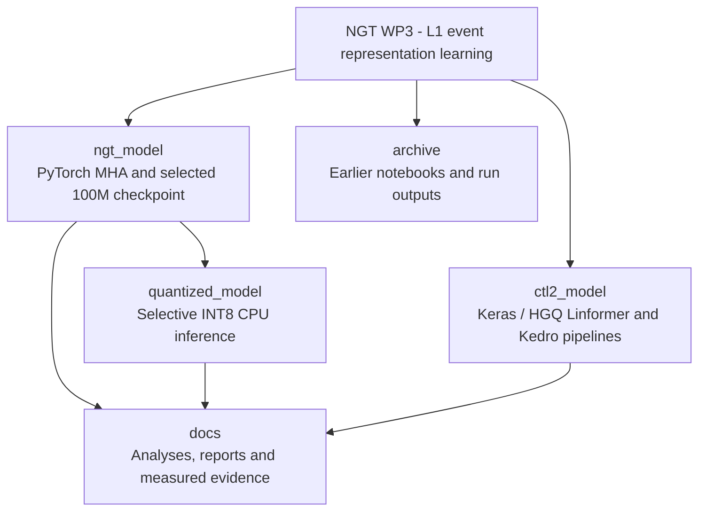

# NGT WP3: representation learning for LHC triggers

CERN Openlab Summer Student 2026 project on compact representations of L1
collision-event candidates for classification, latent-space diagnostics and
anomaly-detection studies. This delivery separates the PyTorch MHA workflow,
its selective quantization prototype and the original Keras/HGQ Linformer project.

## Projects and documentation

| Directory | Purpose | Entry point |
|---|---|---|
| `ngt_model/` | PyTorch MHA training/evaluation, selected 100M checkpoint and scaling tools | [NGT README](ngt_model/README.md) |
| `quantized_model/` | Selective INT8 conversion, CPU inference and paired numerical comparisons | [Quantization README](quantized_model/README.md) |
| `ctl2_model/` | Original Keras/HGQ Linformer with Kedro pipelines and synthesis source | [CTL2 README](ctl2_model/README.md) |
| `docs/` | Delivery guide, analyses, reports, presentations and diagrams | [Documentation index](docs/README.md) |
| `archive/` | Earlier notebooks, dated analysis snapshots and historical outputs | [Archive guide](archive/README.md) |



[Mermaid source](docs/diagrams/repository_overview.mmd).

## Delivered checkpoint and quantization status

The FP32 reference has **99,889,413 parameters** and was trained on the
four-class `minbias,qcd,dy,top` 80M-event configuration. The delivered checkpoint
is **epoch 4**, selected by the lowest validation loss in the available
five-epoch history. The `400ep` suffix in the original run name records the epoch
budget; five completed epochs are documented.

The mixed-precision CPU model quantizes the **two post-pooling dense layers**.
Its artifact is 24.4% smaller and agrees with FP32 on 510/512 pilot predictions
(99.61%). The pilot informed the layer policy and may overlap training.
Independent physics validation and FPGA synthesis of this MHA model remain
pending. Exact measurements and scope are in [the delivery guide](docs/DELIVERY.md).

## Clone and obtain the weights

```bash
git lfs install
git clone --branch master https://gitlab.cern.ch/cms-l1-ad/openlab_ss26.git
cd openlab_ss26
git lfs pull
```

The selected FP32 and mixed-precision weights are tracked with Git LFS. Training
caches and external datasets remain on CERN storage; they are accessed with the
user's own CERN permissions. Paths in historical run metadata identify the
original production location.

## PyTorch setup and quick check

Run from the repository root with Python 3.11:

```bash
python -m venv .venv-ngt
source .venv-ngt/bin/activate
python -m pip install torch==2.5.1 --index-url https://download.pytorch.org/whl/cpu
python -m pip install -e ./ngt_model -e ./quantized_model
python -m unittest discover -s quantized_model/tests -v
```

On PowerShell, activate with `.\.venv-ngt\Scripts\Activate.ps1`. CPU wheels
support the delivered quantized inference path. For GPU training, install the
appropriate PyTorch 2.5.1 build in the training environment and the NGT training
extra: `python -m pip install -e './ngt_model[training]'`.

For [inference and reproduction](quantized_model/README.md), supply either raw
candidate tensors with `--raw-inputs` or tensors transformed with the frozen run
preprocessing. Use the [CTL2 environment](ctl2_model/README.md#environment) for its
Keras/HGQ/Kedro workflow.

## Validation and provenance

[Local checks](docs/LOCAL_CHECKS.json) record the functional suite, package builds,
script checks and artifact integrity. The root GitLab CI configuration runs the
small quantization suite without downloading model weights. Its remote status
is available on the branch pipeline.

[Current diagrams](docs/diagrams/README.md) describe this delivery; earlier
Mermaid architecture diagrams remain available as historical references.
