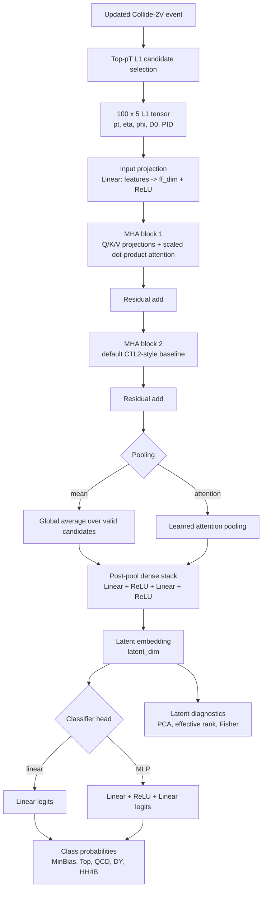

# CTL2 Embedding Model

This repository contains the CERN OpenLab L1 anomaly-detection embedding study. The current work compares L1-only event embeddings for Standard Model processes and HH4B using updated Collide-2V production samples.

The active development now has two complementary workflows:

- **Linformer notebook workflow** for the historical baseline and DY-MinBias studies.
- **PyTorch MHA / `ngt_model` workflow** for scriptable training, MLflow tracking, and eval-quality scaling tests.

All current model inputs are treated as **L1-only**. Gen-level or FullReco information is used only for diagnostics such as DY final-state labeling, not as model input features.

## Repository Layout

```text
ctl2_embedding_model/
|-- analysis/                         # English run-analysis notes
|-- ctl2_model/                        # Original Kedro/CTL2 project
|-- diagnostic_notebooks/              # Dataset and DXY diagnostic notebooks
|-- ngt_linformer_nodes_aligned_outputs/
|   |-- NGT_Linformer_NodesAligned_FullPrecision_Collide2V_L1features.ipynb
|   `-- runs/                          # Selected Linformer run evidence
|-- ngt_mha_nodes_aligned_outputs/
|   |-- NGT_MHA_NodesAligned_FullPrecision_Collide2V_L1features.ipynb
|   |-- runs/                          # Selected MHA run evidence
|   `-- scale_tests/                   # Eval-quality scaling CSVs
|-- ngt_model/                         # Scriptable PyTorch MHA package
|-- .gitignore
|-- .gitlab-ci.yml
`-- README.md
```

## Main Notebooks

The notebooks are intentionally stored inside the workflow folders they produce:

| Workflow | Notebook |
|---|---|
| Linformer baseline and DY-MinBias studies | `ngt_linformer_nodes_aligned_outputs/NGT_Linformer_NodesAligned_FullPrecision_Collide2V_L1features.ipynb` |
| MHA architecture ablation | `ngt_mha_nodes_aligned_outputs/NGT_MHA_NodesAligned_FullPrecision_Collide2V_L1features.ipynb` |

Both notebooks now resolve the repository root automatically, so they can be opened either from the repository root or from their workflow folder without duplicating output paths.

## Current Input Representation

Each event is represented as a `100 x 5` L1 candidate tensor:

```text
[pt, eta, phi, dxy_or_D0, pid]
```

The current updated Collide-2V L1 columns are:

```text
L1T_PUPPIPart_PT
L1T_PUPPIPart_Eta
L1T_PUPPIPart_Phi
L1T_PUPPIPart_D0
L1T_PUPPIPart_PID
```

Preprocessing follows the same logic across the notebooks and `ngt_model`:

- `pt`: `log1p` transform followed by training-split min-max scaling.
- `eta`: training-split min-max scaling.
- `phi`: fixed scaling from `[-pi, pi]` to `[0, 1]`.
- `dxy_or_D0`: kept as the L1 D0/DXY-like value.
- `pid`: mapped from the training split and one-hot encoded.
- Candidates are selected with `top_pt`.

## `ngt_model`

`ngt_model/` contains the scriptable PyTorch MHA workflow extracted from notebook development.

## Model Architecture

The active MHA workflow follows the CTL2 particle-level idea: each event is treated as a set
of up to 100 L1 candidates, attention blocks act as event featurizers, and the pooled event
representation is compressed into a fixed-size latent embedding.



The scriptable ablations keep this flow fixed and change one component at a time:

- `num_attention_blocks`: `1`, `2`, `4`.
- `pooling_mode`: `mean` vs `attention`.
- `classifier_head`: `linear` vs `mlp`.
- `ff_dim`: `64`, `128`, `256`.
- `num_heads`: `4`, `8`, `16`.
- `latent_var_reg_weight`: CrossEntropy-only vs CrossEntropy plus latent variance regularization.

Key modules:

- `ngt_model/src/ngt_model/datasets/collide2v_data.py`: L1-only updated Collide-2V loading, preprocessing, splits, PID mapping, and augmentation helpers.
- `ngt_model/src/ngt_model/models/mha_model.py`: MHA embedding model and latent-only wrapper.
- `ngt_model/src/ngt_model/training/train_mha.py`: training entry point with optional MLflow logging.
- `ngt_model/src/ngt_model/evaluation/eval_quality_collide2v.py`: Collide-2V adaptation of the eval-quality metric.
- `ngt_model/src/ngt_model/evaluation/scale_test.py`: small-to-reasonable eval-quality scaling sweep.
- `ngt_model/src/ngt_model/evaluation/latent_diagnostics.py`: PCA/eigenvalue effective-dimensionality diagnostic.
- `ngt_model/src/ngt_model/evaluation/latent_fisher.py`: empirical Fisher diagnostic in latent space.
- `ngt_model/src/ngt_model/evaluation/head_fisher.py`: classifier-head Fisher approximation.
- `ngt_model/src/ngt_model/evaluation/seed_sweep.py`: repeated-seed sweep for uncertainty estimates.
- `ngt_model/src/ngt_model/evaluation/dataset_size_sweep.py`: fixed-architecture dataset-size sweep.
- `ngt_model/src/ngt_model/evaluation/summary_table.py`: unified run/sweep summary table builder.

Run from the repository root:

```bash
export PYTHONPATH=$PWD/ngt_model/src:$PYTHONPATH
python -m ngt_model.training.train_mha --help
```

## MLflow

The MHA training and scaling sweep can log to CERN MLflow under the `ngt_model` experiment:

```bash
python -m ngt_model.training.train_mha \
  --data-source collide2v_updated \
  --n-events-per-class 100000 \
  --epochs 30 \
  --latent-dim 128 \
  --mlflow-enable \
  --mlflow-experiment ngt_model \
  --run-name mha_l1_only_100k_latent128
```

Eval-quality scaling sweep:

```bash
python -m ngt_model.evaluation.scale_test \
  --grid scaling \
  --epochs 5 \
  --eval-events-per-class 2000 \
  --data-source collide2v_updated \
  --mlflow-enable \
  --mlflow-experiment ngt_model \
  --mlflow-run-name scaling_eval_quality \
  --output ngt_mha_nodes_aligned_outputs/scale_tests/scaling_eval_quality.csv
```

## Collapse Diagnostics and Scaling Checks

The current latent-collapse follow-up uses four complementary checks:

```bash
# 1. PCA/eigenvalue latent effective dimensionality
python -m ngt_model.evaluation.latent_diagnostics \
  ngt_mha_nodes_aligned_outputs/runs/2026-07-15/hh4b_full_sm_100k_latent128

# 2. Latent-space empirical Fisher
python -m ngt_model.evaluation.latent_fisher \
  ngt_mha_nodes_aligned_outputs/runs/2026-07-15/hh4b_full_sm_100k_latent128 \
  --n-events-per-class 2000

# 3. Classifier-head Fisher approximation
python -m ngt_model.evaluation.head_fisher \
  ngt_mha_nodes_aligned_outputs/runs/2026-07-15/hh4b_full_sm_100k_latent128 \
  --n-events-per-class 2000

# 4. Unified summary table from runs and sweep CSVs
python -m ngt_model.evaluation.summary_table \
  --run-root ngt_mha_nodes_aligned_outputs/runs \
  --sweep-csvs ngt_mha_nodes_aligned_outputs/scale_tests/latent_dim_sweep_hh4b_100k_combined.csv \
  --output ngt_mha_nodes_aligned_outputs/scale_tests/unified_experiment_summary.csv
```

Repeated seeds and dataset-size sweeps are available as scriptable entry points:

```bash
python -m ngt_model.evaluation.seed_sweep \
  --seeds 42,43,44 \
  --n-events-per-class 100000 \
  --latent-dim 32 \
  --mlflow-enable \
  --mlflow-experiment ngt_model

python -m ngt_model.evaluation.dataset_size_sweep \
  --event-sizes 100000,200000,300000 \
  --latent-dim 32 \
  --mlflow-enable \
  --mlflow-experiment ngt_model
```

The current anti-collapse objective test is available directly in `train_mha.py`:

```bash
python -m ngt_model.training.train_mha \
  --data-source collide2v_updated \
  --class-names minbias,top,qcd,dy,hh4b \
  --n-events-per-class 100000 \
  --latent-dim 32 \
  --ff-dim 128 \
  --num-heads 8 \
  --num-attention-blocks 2 \
  --pooling-mode mean \
  --classifier-head linear \
  --latent-var-reg-weight 0.01 \
  --latent-var-target 1.0 \
  --eval-quality-events 2000 \
  --mlflow-enable \
  --mlflow-experiment ngt_model
```

Local MLflow credentials belong in:

```text
ngt_model/conf/local/credentials.yml
ctl2_model/conf/local/credentials.yml
```

These files are ignored by Git and must not be committed.

## Analysis Notes

Run analyses are stored in `analysis/`. They summarize the important runs, dataset diagnostics, and conclusions without forward-looking planning sections.

Important recent notes:

- `analysis/2026-07-11_updated_collide2v_run.md`
- `analysis/2026-07-13_mha_eval_quality_analysis.md`
- `analysis/2026-07-14_mha_l1_100k_eval_quality.md`
- `analysis/2026-07-21_hh4b_collapse_diagnostics.md`
- `analysis/2026-07-23_week2_latent_collapse_report.md`

## Output Policy

Git intentionally ignores local cache and diagnostic-output folders:

```text
ngt_linformer_nodes_aligned_outputs/cache/
ngt_linformer_nodes_aligned_outputs/diagnostic_notebooks/
ngt_linformer_nodes_aligned_outputs/diagnostics/

ngt_mha_nodes_aligned_outputs/cache/
ngt_mha_nodes_aligned_outputs/diagnostic_notebooks/
ngt_mha_nodes_aligned_outputs/diagnostics/

**/conf/local/credentials.yml
```

Selected run summaries, plots, CSVs, notebooks, and analysis notes can be versioned as evidence. Large regenerated caches and local credentials should stay out of Git.

## Current Findings

The latest L1-only MHA work shows:

- HH4B is visible against the full SM background, but overlaps significantly with Top-like activity.
- DY remains one of the most difficult classes and still overlaps with MinBias-like regions.
- Latent collapse is stable across seeds and is not solved by increasing latent dimension, dataset size, attention depth, or number of heads alone.
- Mean pooling and a linear classifier head provide a strong supervised baseline.
- `ff_dim=256` improves HH4B F1 but does not remove low effective dimensionality.
- A small latent variance regularizer (`latent_var_reg_weight=0.01`) improves effective rank, participation ratio, head-Fisher dimensionality, HH4B F1, DY F1, and eval-quality with only a small accuracy cost.
