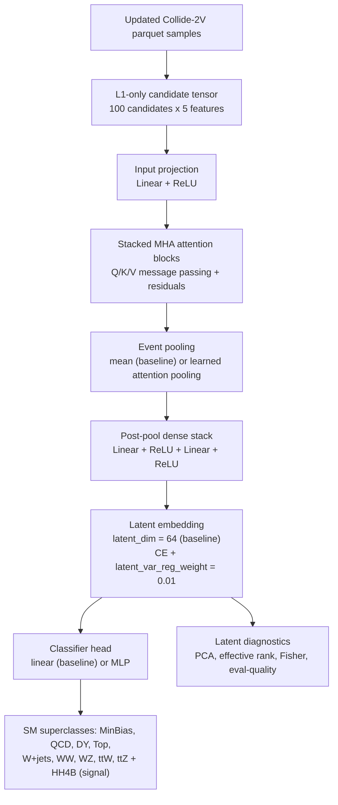

# openlab_ss26

Repository for the CERN Openlab Summer Student 2026 project:

**NGT WP3 Representation Learning for LHC Triggers**

This project studies L1-only machine-learning representations of simulated LHC collision events for Level-1 trigger and anomaly-detection workflows. The current focus is to learn compact latent spaces where Standard Model processes and candidate anomaly signals such as HH4B can be compared, while keeping the input representation compatible with L1 trigger information.

Project notes and meeting context are tracked in the CERN CodiMD page:

- <https://codimd.web.cern.ch/s/oEeoJz7QJ>

## Project Status

Current safe baseline:

- Updated Collide-2V production parquet workflow implemented.
- L1-only inputs from `L1T_PUPPIPart_*` branches.
- Linformer notebook baseline preserved for historical DY-MinBias studies.
- PyTorch MHA workflow added under `ctl2_embedding_model/ngt_model/`.
- HH4B-vs-full-SM benchmark added with `minbias,top,qcd,dy` as background.
- Latent-collapse diagnostics added: PCA/effective rank, latent Fisher, classifier-head Fisher, and eval-quality.
- Supervised architecture ablations completed for pooling, classifier head, attention blocks, `ff_dim`, and `num_heads`.
- CrossEntropy plus small latent variance regularization was added as the first objective-level anti-collapse test.
- Notebook paths were updated so notebooks can live inside their workflow output folders.
- Best-configuration convergence, a granular-label test, a broader SM superclass benchmark, and six loss-objective variants were added to the latent-collapse study.

Main current finding:

- Latent collapse is stable across seeds and is not solved by increasing nominal latent dimension, dataset size, attention depth, or number of heads alone.
- Mean pooling and linear classifier heads are good supervised baselines.
- `ff_dim=256` improves HH4B F1 but does not remove low effective dimensionality.
- A small latent variance regularizer (`lambda=0.01`) improves effective rank, participation ratio, head-Fisher dimensionality, HH4B F1, DY F1, and eval-quality with only a small accuracy cost.
- The best supervised configuration now uses `latent_dim=64` (selected from the granular-label sweep for its balance of HH4B F1, DY F1, and eval-quality).
- More granular physics labels (splitting `Top`/`WW` by final state) increase effective latent dimensionality, supporting the hypothesis that label granularity, not only architecture, shapes the collapse.
- On a broader 10-class SM superclass benchmark, covariance-regularized objectives raise effective rank and eval-quality the most, but no single loss-objective variant clearly wins on HH4B F1 as well - model selection needs multiple metrics together. See "Latent-Collapse Findings" below for details and caveats.

## Repository Layout

```text
.
|-- README.md
`-- ctl2_embedding_model/
    |-- README.md
    |-- analysis/
    |-- ctl2_model/
    |-- diagnostic_notebooks/
    |-- diagnostics/
    |-- ngt_linformer_nodes_aligned_outputs/
    |   |-- NGT_Linformer_NodesAligned_FullPrecision_Collide2V_L1features.ipynb
    |   `-- runs/
    |-- ngt_mha_nodes_aligned_outputs/
    |   |-- NGT_MHA_NodesAligned_FullPrecision_Collide2V_L1features.ipynb
    |   |-- runs/
    |   `-- scale_tests/
    `-- ngt_model/
        |-- conf/
        |-- data/
        |-- src/ngt_model/
        `-- tests/
```

## Main Workflows

| Workflow | Location | Purpose |
|---|---|---|
| Linformer notebook | `ctl2_embedding_model/ngt_linformer_nodes_aligned_outputs/NGT_Linformer_NodesAligned_FullPrecision_Collide2V_L1features.ipynb` | Historical baseline and DY-MinBias studies |
| MHA notebook | `ctl2_embedding_model/ngt_mha_nodes_aligned_outputs/NGT_MHA_NodesAligned_FullPrecision_Collide2V_L1features.ipynb` | MHA architecture comparison |
| Scriptable MHA package | `ctl2_embedding_model/ngt_model/` | PyTorch training, MLflow logging, and eval-quality tests |

The notebooks now resolve the project root automatically. This avoids broken relative paths after moving the notebooks into their workflow folders.

## Current Model Flow



The current ablation campaign changes one component at a time: pooling, classifier head,
number of attention blocks, `ff_dim`, number of attention heads, and latent variance regularization. This is used to study
whether the low effective dimensionality is caused by architecture choices or by the
cross-entropy training objective.

The latent-collapse follow-up added two further controlled axes on top of this baseline: label granularity (splitting `Top`/`WW`
into final-state sub-classes) and loss-objective design (six CrossEntropy-based variants, evaluated on a
broader 10-class SM superclass benchmark). See "Latent-Collapse Findings" below.

## L1-Only Inputs

The current updated Collide-2V representation uses a `100 x 5` tensor per event:

```text
[pt, eta, phi, dxy_or_D0, pid]
```

For updated Collide-2V, these are read from:

```text
L1T_PUPPIPart_PT
L1T_PUPPIPart_Eta
L1T_PUPPIPart_Phi
L1T_PUPPIPart_D0
L1T_PUPPIPart_PID
```

Gen-level or FullReco information is not used as model input. It is only used for diagnostics, for example when studying DY final-state subgroups.

## MHA Training

From `ctl2_embedding_model/`:

```bash
export PYTHONPATH=$PWD/ngt_model/src:$PYTHONPATH
python -m ngt_model.training.train_mha \
  --data-source collide2v_updated \
  --n-events-per-class 100000 \
  --epochs 30 \
  --latent-dim 128 \
  --mlflow-enable \
  --mlflow-experiment ngt_model \
  --run-name mha_l1_only_100k_latent128
```

Eval-quality scaling sweep:

```bash
python -m ngt_model.evaluation.scale_test \
  --grid scaling \
  --epochs 5 \
  --eval-events-per-class 2000 \
  --data-source collide2v_updated \
  --mlflow-enable \
  --mlflow-experiment ngt_model \
  --mlflow-run-name scaling_eval_quality \
  --output ngt_mha_nodes_aligned_outputs/scale_tests/scaling_eval_quality.csv
```

## Analysis Notes

English analysis notes are stored in:

```text
ctl2_embedding_model/analysis/
```

Recent analysis files:

- `2026-07-11_updated_collide2v_run.md`
- `2026-07-13_mha_eval_quality_analysis.md`
- `2026-07-14_mha_l1_100k_eval_quality.md`
- `2026-07-21_hh4b_collapse_diagnostics.md`
- `2026-07-24_latent_collapse_report.md`
- `2026-07-28_best_config_finding_and_latent_sweep.md`
- `2026-07-31_superclass_loss_objective_comparison.md`

Presentation materials are kept locally in `ctl2_embedding_model/presentations/` and ignored by Git.

## Latent-Collapse Findings (exploratory, controlled tests)

The latest latent-collapse follow-up moved from diagnosing low effective dimensionality to selecting a stronger supervised
baseline, along three controlled axes. These are single-setting exploratory runs, not a final
model choice, and are flagged accordingly below:

- **Best configuration**: converged on `latent_dim=64` (previously `32`), keeping
  `latent_var_reg_weight=0.01`. `latent_dim=64` was selected for its balance of HH4B F1,
  DY F1, and eval-quality across the granular-label sweep, not because it maximizes any single metric.
- **Label granularity**: splitting `Top`/`WW` into final-state sub-classes (`tt_hadronic`,
  `tt_leptonic`, `tt_semileptonic`, `WW_hadronic`, `WW_leptonic`, `WW_semileptonic`) made
  classification harder (accuracy ~0.62 -> ~0.46) but raised effective latent dimensionality well
  beyond the coarse-label case (effective rank ~10.5 at `latent_dim=32`, ~16.6 at `latent_dim=128`).
  This supports, but does not prove, the idea that coarse labels contributed to the earlier collapse.
  A non-monotonic dip at `latent_dim=64` (effective rank 3.07) is unexplained and needs a repeat run.
- **Broader SM superclass benchmark**: expanded the benchmark from 5 to 10 classes (`MinBias, QCD,
  DY, Top, W+jets, WW, WZ, ttW, ttZ, HH4B`), giving a more realistic SM background against which HH4B
  is evaluated as the anomaly candidate.
- **Six loss-objective variants** (CE + variance, + label smoothing, focal, + SupCon at two
  strengths, + covariance regularization at two strengths) were compared on this broader benchmark.
  Covariance-regularized variants reach the highest effective rank (~27-29) and eval-quality
  (~0.13-0.23); SupCon variants give the best DY F1; label smoothing gives the highest accuracy but
  near-zero eval-quality. HH4B F1 stays essentially flat (0.557-0.561) across all six variants, so no
  single objective is a clear anomaly-detection win yet, and model selection needs to stay
  multi-metric rather than optimizing one number.
- **Reproducibility caveat**: the granular-label sweep and five of the six loss-objective runs
  currently exist only as reported numbers in the analysis notes above; only the covariance-0.005 run
  has an independent output directory on disk. Treat these as directional evidence pending fuller
  logging.

Details, per-run tables, and figure references: `analysis/2026-07-28_best_config_finding_and_latent_sweep.md`,
`analysis/2026-07-31_superclass_loss_objective_comparison.md`.

## Safe Output Policy

The repository keeps notebooks, analysis notes, selected CSV/JSON run summaries, and small curated evidence files.

The repository intentionally does not track:

- local credentials,
- generated caches,
- model checkpoints,
- large `.npy` tensors,
- diagnostic outputs that can be regenerated.

MLflow credentials should stay only in local ignored files such as:

```text
ctl2_embedding_model/ngt_model/conf/local/credentials.yml
ctl2_embedding_model/ctl2_model/conf/local/credentials.yml
```
