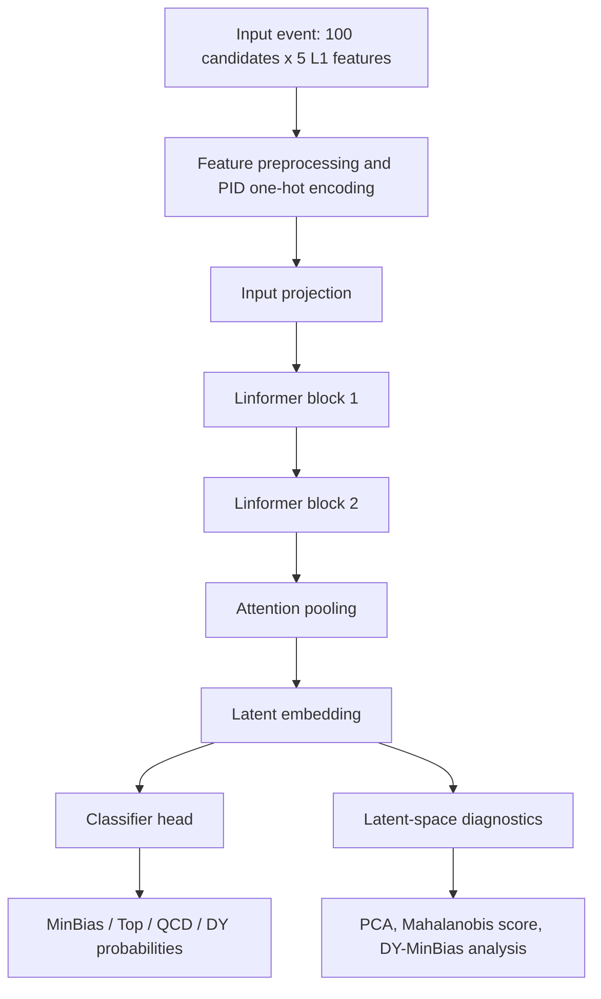

# CTL2 Embedding Model

This folder contains the OpenLab DY-MinBias L1 embedding study. The current code focuses on a full-precision PyTorch Linformer-style model trained on L1 candidate tensors for MinBias, Top, QCD, and DY classification, with latent-space diagnostics for anomaly detection and class separation.

## Current Safe Baseline

The current safe notebook version is:

`NGT_Linformer_NodesAligned_FullPrecision_Collide2V_L1features.ipynb`

The notebook is configured by default for the updated Collide-2V dataset:

- `DATA_SOURCE = 'collide2v_updated'`
- 100,000 events per class
- L1-only inputs from `L1T_PUPPIPart_PT`, `L1T_PUPPIPart_Eta`, `L1T_PUPPIPart_Phi`, `L1T_PUPPIPart_D0`, and `L1T_PUPPIPart_PID`
- top-pT candidate selection
- 100 candidates per event
- supervised classifier for MinBias, Top, QCD, and DY
- latent-space outputs for PCA, Mahalanobis score, and DY-MinBias diagnostics

## Input Representation

Each event is represented as a `100 x 5` tensor:

```text
[pt, eta, phi, dxy_or_D0, pid]
```

The preprocessing follows the same logic used for the aligned `ctl2_model` inputs:

- `pt`: `log1p` transform followed by training-split min-max scaling
- `eta`: training-split min-max scaling
- `phi`: fixed scaling from `[-pi, pi]` to `[0, 1]`
- `dxy_or_D0`: copied directly, without min-max scaling
- `pid`: mapped from the training split and one-hot encoded

## Relation To `ctl2_model`

The notebook is aligned with the `ctl2_model` tensor structure and preprocessing used by `nodes.py` and `preprocessing.py`. It is not a bit-for-bit copy of the original `linformer.py` implementation because the original model is Keras/HGQ-oriented and quantization-aware, while this notebook uses full-precision PyTorch for rapid experimentation.

The high-level structure is kept consistent:



## Analysis Notes

Run analyses are stored in `analysis/`. These notes summarize the important runs, dataset diagnostics, and conclusions without forward-looking planning sections.

The updated Collide-2V safe baseline is documented in:

`analysis/2026-07-11_updated_collide2v_run.md`

## Output Policy

The following local output folders are intentionally ignored by git:

- `ngt_linformer_nodes_aligned_outputs/cache/`
- `ngt_linformer_nodes_aligned_outputs/diagnostic_notebooks/`
- `ngt_linformer_nodes_aligned_outputs/diagnostics/`

Selected run artifacts under `ngt_linformer_nodes_aligned_outputs/runs/` are versioned when they are needed as evidence for the analysis.
