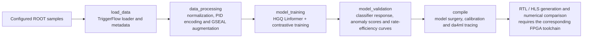

# CTL2 model: Keras/HGQ Linformer

This separate Kedro project preserves the original quantization-aware Linformer
workflow for L1 event representations. The training node constructs the encoder
from `src/ctl2_model/models/linformer.py` and wraps it in `ContrastiveHGQEncoder`.
The NGT 100M checkpoint and its PyTorch INT8 conversion live in the sibling
[NGT](../ngt_model/README.md) and [quantization](../quantized_model/README.md) projects.

## Pipeline



[Mermaid source](../docs/diagrams/ctl2_pipeline.mmd).

| Kedro pipeline | Main source | Purpose |
|---|---|---|
| `load_data` | `src/ctl2_model/pipelines/load_data/` | Load configured samples and metadata |
| `data_processing` | `src/ctl2_model/pipelines/data_processing/` | Prepare features and augmented training pairs |
| `model_training` | `src/ctl2_model/pipelines/model_training/` | Train the HGQ encoder and save Keras artifacts |
| `model_validation` | `src/ctl2_model/pipelines/model_validation/` | Produce classification and anomaly diagnostics |
| `compile` | `src/ctl2_model/pipelines/compile/` | Calibrate, trace and generate synthesis artifacts |

The Linformer uses two `QLinformerAttention` blocks, quantized dense projections,
residual additions and sequence averaging with `QSum`. The shared configuration
currently requests a 16-dimensional latent space, width 32, two heads and
`proj_k=8`. Actual feature counts and labels must match the preprocessed datasets
and `conf/base/parameters.yml`; these are separate from the NGT raw-PID inputs.

## Environment

Run CTL2 commands from `ctl2_model/`. The base environment specification is
[environment.yml](environment.yml):

```bash
cd ctl2_model
conda env create --name ctl2-training -f environment.yml
conda activate ctl2-training
python -m pip install -e .
```

The source also imports Keras, HGQ, MLflow and da4ml. The environment specification
and package metadata are not a complete lock of that CERN training/synthesis
stack. Reuse a compatible CERN environment and verify these imports before
launching a pipeline:

```bash
python -c "import keras, hgq, mlflow, da4ml; print('CTL2 framework imports OK')"
kedro registry list
```

The training node creates an HGQ `Dataset` on `gpu:0`. RTL/HLS generation also
requires compatible synthesis tools and FPGA support. Training and synthesis
were not rerun as part of this delivery's PyTorch validation.

## Data and configuration

- [conf/base/parameters.yml](conf/base/parameters.yml): dataset sizes, augmentation,
  architecture, objective schedules, validation settings and synthesis targets.
- [conf/base/catalog.yml](conf/base/catalog.yml): Kedro datasets and data-tier paths.
- [data/01_raw/samples.json](data/01_raw/samples.json) and
  [settings.json](data/01_raw/settings.json): input sample descriptions.
- [conf/README.md](conf/README.md): local catalog overrides and credential setup.

Review CERN paths in local catalog/sample configuration for your account. Copy
`conf/local/credentials.example.yml` to the ignored `credentials.yml` and enter
your own MLflow credentials when required.

The data tiers are `01_raw`, `02_loaded`, `03_preprocessed`, `04_models`,
`05_validation` and `06_compile`. Generated data and models are ignored by Git.

## Execute explicit pipeline stages

With data access, credentials and the compatible framework environment ready:

```bash
kedro run --pipeline=load_data
kedro run --pipeline=data_processing
kedro run --pipeline=model_training
kedro run --pipeline=model_validation
kedro run --pipeline=compile
```

The preserved [CERN CI reference](../docs/ci/ctl2_training_pipeline.yml) describes
the GPU/EOS training workflow. The repository root CI runs PyTorch unit tests;
CTL2 deployment requires its own runner configuration. `dvc.yaml` is a placeholder
and does not define an executable end-to-end reproduction pipeline.

## Synthesis scope

The compile source supports model truncation, HGQ range calibration, da4ml
tracing, RTL/HLS generation and numerical comparisons. The configured FPGA target
is `xcvu13p-flga2577-2-e`, with a 5.556 ns requested clock period. These are tool
inputs; this delivery does not establish achieved timing, resource usage or a
deployed TriggerModel.

The earlier README and its Mermaid diagram are preserved in the
[historical workflow reference](../docs/historical/ctl2_workflow_reference.md).
