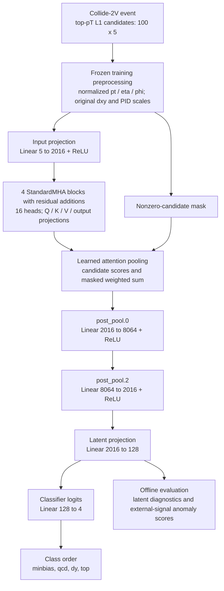

# NGT model

PyTorch multi-head-attention event encoder, training and evaluation tools for
Collide-2V L1 candidate inputs.

## Final run

[final_run/](final_run/README.md) contains the selected 99,889,413-parameter
checkpoint, its frozen configuration, five-epoch history and original evaluation
evidence. Epoch 4 has the lowest recorded validation loss. The source run name
contains a 400-epoch budget; five completed epochs are available locally.

The selected model uses 100 candidates, five features with raw PID encoding,
four attention blocks, 16 heads, attention pooling, a 128-dimensional latent
space and the class order `minbias,qcd,dy,top`. The exact input transforms and
architecture come from `final_run/run_config.json`.

## Delivered inference graph



[Mermaid source](../docs/diagrams/ngt_100m_architecture.mmd).

Each attention block performs full scaled dot-product attention followed by a
residual addition. The `ff_dim=8064` dense stack is after pooling; the implementation
does not add a feed-forward sublayer inside each attention block. Candidate
masking is applied in pooling. The original attention and preprocessing behavior
is preserved when loading the delivered checkpoint.

Training uses CE with SupCon/InfoNCE weight 0.05 in the selected run. These losses
shape the weights; offline density fits, PCA, Fisher diagnostics and the losses
are separate from the inference graph.

## Layout

```text
ngt_model/
  src/ngt_model/       model, datasets, training, evaluation and pipelines
  conf/               generic research defaults and local configuration
  final_run/          selected checkpoint, original config and evidence
  scaling_study/      launch/resume commands, configs, benchmarks and summaries
  pyproject.toml
  requirements.txt
```

Run commands from the delivery repository root. Install the inference package
with Python 3.11:

```bash
python -m pip install -e ./ngt_model
```

For training and the full evaluation toolchain:

```bash
python -m pip install -e './ngt_model[training]'
python -m ngt_model.training.train_mha --help
```

Alternatively expose the source directly:

```bash
export PYTHONPATH="$PWD/ngt_model/src:${PYTHONPATH:-}"
```

The launch scripts under `scaling_study/large_100m_80m/commands/` resolve the new
repository root. Training outputs still use `outputs/scaling_study/...`, keeping
their original run identifiers and cache names. Credentials remain in local
ignored configuration. The launch commands are explicit; choose the data paths and compute allocation before running a training job.

## Related material

- [Quantization project](../quantized_model/README.md): the separate CPU inference
  and numerical comparison package derived from the selected checkpoint.
- [Delivery guide](../docs/DELIVERY.md): measured results and validation scope.
- [Analysis index](../docs/analysis/README.md): research findings.
- [Earlier workflow reference](../docs/historical/ngt_workflow_reference.md):
  historical examples, including earlier configurations with different features.

The generic `conf/base/parameters.yml` is retained for the broader research
workflow. Use the selected run configuration to recreate the delivered model.
