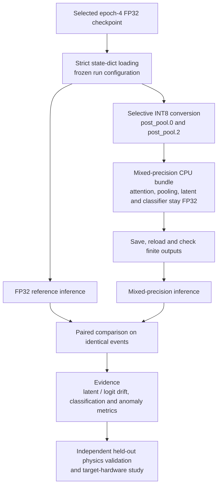

# NGT quantized model

CPU INT8 inference and reproducible numerical validation for the existing NGT
PyTorch MHA encoder.

## Conversion and validation flow



[Mermaid source](../docs/diagrams/quantization_workflow.mmd).

## Delivered architecture and checkpoint

The source is the actual 80M-event CE + InfoNCE run from 2026-08-24:

`scaling_4class_80m_dmodel2016_ff8064_100m_400ep_noaug_ce_infonce005_lr1e5_seed42`

The local history contains **five completed epochs**, despite the 400-epoch budget
in the run name. Epoch **4** is selected by the lowest recorded validation loss
(1.2682188015); epoch 5 has validation loss 1.2761274650. This is a conversion of
an existing checkpoint, not a new training campaign or a completed 400-epoch run.

| Field | Value |
|---|---|
| Trainable FP32 parameters | 99,889,413 |
| Candidates / features | 100 / 5, raw PID encoding |
| Feature order | pt, eta, phi, dxy, pid |
| Model width / post-pool FF width | 2016 / 8064 |
| Heads / attention blocks | 16 / 4 |
| Pooling / classifier | learned attention / linear |
| Latent dimension | 128 |
| Trained class order | minbias, qcd, dy, top |
| Objective | CE + SupCon/InfoNCE weight 0.05 |

The authoritative architecture and frozen normalization are in
`conf/base/source_run_config.json`. Do not substitute the older 24-feature
one-hot model or generic research defaults. Use the frozen run configuration
when recreating the selected checkpoint.

## Precision and framework choice

The selected `post_pool_int8` policy uses PyTorch 2.5.1 dynamic quantization with
per-output-channel INT8 weights for the **two post-pooling Linear layers**.
The input projection, attention projections, latent projection, classifier and
pooling score remain FP32. Activations are dynamically quantized within the two
converted operations; their interfaces return FP32. Attention matrix products,
softmax, residual additions, ReLU and pooling remain FP32.

The delivered bundle is 302,201,316 bytes versus 399,573,270 bytes for the source
checkpoint (24.4% smaller). Quantizing 22 dense layers reduced the bundle to
100.8MB but prediction agreement collapsed to 27.3% in the 512-event pilot.
Quantizing value/output attention projections also failed the sensitivity study.
Those results are retained in `evidence/rejected_dense_int8_comparison.json` and
`evidence/layer_sensitivity.json`. The rejected fourfold compression is **not**
the selected model. The source checkpoint size includes a small amount of
training metadata, so the ratio is a measured artifact ratio, not a pure tensor
storage comparison. Speedup is not assumed.

This retains the trained PyTorch graph and weights. QKeras would require a Keras
port and a separate equivalence study. This package does **not** provide QAT,
integer-only attention, CUDA INT8 inference, ONNX/HLS export, or FPGA synthesis.
The legacy `torch.ao.quantization` API is pinned deliberately for this reproducible
CPU baseline; current PyTorch development is moving to TorchAO.

Upstream references:

- [PyTorch dynamic quantization](https://docs.pytorch.org/docs/2.5/generated/torch.ao.quantization.quantize_dynamic.html)
- [QKeras](https://github.com/google/qkeras)
- [PyTorch quantization migration](https://docs.pytorch.org/docs/stable/quantization.html)

## Layout

```text
quantized_model/
  conf/base/source_run_config.json
  src/quantized_model/       conversion, loading, inference and comparison
  tests/                    functional tests on a small synthetic architecture
  models/                   delivered INT8 bundle, downloaded through Git LFS
  evidence/                 manifest, measured comparison and cohort provenance
  data/                     regenerated local tensors; ignored
  outputs/                  regenerated inference arrays; ignored
```

The delivered bundle is in `models/` and uses Git LFS. Recreated bundles go
under the ignored `artifacts/` directory to keep generated experiments separate.

## Setup

From the repository root, with Python 3.11:

```bash
git lfs pull
python -m venv .venv-quantized
source .venv-quantized/bin/activate
python -m pip install torch==2.5.1 --index-url https://download.pytorch.org/whl/cpu
python -m pip install -e ./ngt_model -e ./quantized_model
export PYTHONPATH="$PWD/ngt_model/src:$PWD/quantized_model/src:${PYTHONPATH:-}"
python -m unittest discover -s quantized_model/tests -v
```

PowerShell activation and module paths:

```powershell
.\.venv-quantized\Scripts\Activate.ps1
$env:PYTHONPATH="$PWD/ngt_model/src;$PWD/quantized_model/src"
```

## Inference

All commands below run from the delivery repository root. `--raw-inputs` applies the
**original** training normalization. It preserves the original padding and PID
behavior without recomputing normalization or changing the mask semantics.
Input candidates must already be selected/sorted with the original top-pT rule.

```bash
python -m quantized_model.predict \
  --bundle quantized_model/models/ngt_100m_epoch004_postpool_int8.pt \
  --inputs /path/to/raw_events.npy --raw-inputs \
  --output quantized_model/outputs/predictions.npz
```

The `.npz` contains `latent [N,128]`, `logits [N,4]`, and `class_names`.
Omit `--raw-inputs` only for tensors already transformed with the same frozen
preprocessing. Raw and preprocessed inputs both have five features in this run;
the code cannot infer their interpretation from shape.

## Recreate the conversion

The epoch checkpoint is a tensor state dictionary; loading uses
`weights_only=True` and `strict=True`. Unknown or mismatched weights fail; there
is no fallback to randomly initialized weights.

```bash
python -m quantized_model.convert \
  --checkpoint ngt_model/final_run/models/checkpoint_epoch_004.pt \
  --run-config quantized_model/conf/base/source_run_config.json \
  --output quantized_model/artifacts/recreated_int8.pt
```

This also reloads the result and checks finite inference on fully padded events.
The manifest records source and artifact SHA256, backend, version, layer coverage,
and actual file sizes. Binary hashes can differ after regeneration even if
numerical outputs are equal; the delivered hashes identify the delivered files.
Use the same pinned PyTorch version/backend when loading the bundle.

## Numerical and physics comparison

`evidence/comparison.json` records the measured local pilot: 510/512 predictions
agree (99.609375%), accuracy is unchanged at 0.501953125, and latent relative L2
drift is 0.00520945. This cohort also informed the policy choice. Its events come
from historical external-evaluation caches and **may overlap training**. Its
classification and anomaly numbers are numerical diagnostics, not independent
physics acceptance. The small signal/background tails cannot establish 99.5%
rejection performance. CPU timings are specific to batch size, thread count and
the execution host, and are not trigger latency measurements.

For an independent rerun on CERN storage, recover the original DDP rank holdout:

```bash
python -m quantized_model.prepare_holdout \
  --run-config quantized_model/conf/base/source_run_config.json \
  --cache-dir /eos/path/to/one_24h_100m/cache \
  --rank 0 --events-per-class 1000 \
  --output quantized_model/data/holdout_rank0
```

This memory-maps the four original 5M-event shard caches, reproduces the training
split RNG, and extracts evaluation events plus a disjoint MinBias validation
reference. CERNBox may need to download entire 10GB cache files to access them;
prefer execution directly on EOS. An exact held-out extraction was not completed
locally. Raw caches are not stored in Git.

```bash
python -m quantized_model.compare \
  --checkpoint ngt_model/final_run/models/checkpoint_epoch_004.pt \
  --bundle quantized_model/models/ngt_100m_epoch004_postpool_int8.pt \
  --inputs quantized_model/data/holdout_rank0/eval_raw.npy \
  --labels quantized_model/data/holdout_rank0/eval_labels.npy --raw-inputs \
  --cohort-description 'Original rank-0 evaluation split' \
  --minbias-fit-inputs quantized_model/data/holdout_rank0/minbias_fit_raw.npy \
  --signal hh4b=/path/to/independent_hh4b_raw.npy \
  --signal vbfh=/path/to/independent_vbfh_raw.npy \
  --batch-size 8 --threads 4 --output quantized_model/outputs/heldout_rank0
```

The comparison reports latent/logit drift, prediction agreement, accuracy,
macro-F1, and MinBias Mahalanobis AUC/efficiencies at 95%, 99% and 99.5% background
rejection. It evaluates both a refitted INT8 detector and the frozen FP32 detector.
The reference uses Ledoit-Wolf directly on the latent space, without the PCA/GMM
pipeline of the historical Higgs evaluation; do not equate their metrics.

Background fit and background evaluation must be disjoint; external signals must
be independent. This script does not prove event independence from arbitrary
input files. Acceptance thresholds and FPGA feasibility require a separate
physics/hardware review. Fine-tuning with QAT and an attention synthesis study
are subsequent work if the measured quantization drift is unacceptable.
